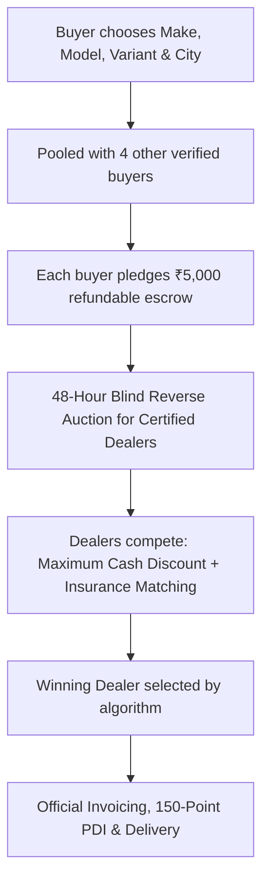

# AutoPool India (ऑटोपूल इंडिया)
### Collective Car Buying & Dealer Reverse-Auction Platform

> **"Stop begging car dealers for free floor mats. Pool together with 5+ buyers in your city and unlock wholesale fleet discounts."**

---

## 📌 1. Problem Statement

When an individual walks into an authorized car showroom in India to buy a car:
1. **Asymmetric Information & Power**: The dealer holds all cards. Haggling is stressful, time-consuming, and subjective.
2. **Gimmicky "Freebies" instead of Real Cash Savings**: Instead of genuine cash discounts, dealers push unwanted accessory kits (basic floor mats, mudflaps, fake chrome strips) with a manufactured retail value of ₹25,000–₹45,000 that costs them under ₹4,000.
3. **Showroom Insurance Markups**: Dealers mark up insurance policies by 40%–60% over online rates and often falsely claim "buying insurance outside voids the OEM warranty".
4. **Lack of Volume Leverage**: A single retail customer buying 1 car has zero leverage. However, car dealerships operate on **OEM Monthly Volume Milestones** (bonuses paid out by Maruti, Hyundai, Tata, etc. if they hit monthly delivery quotas).

---

## 💡 2. The AutoPool Solution

AutoPool aggregates **5+ committed buyers** looking for the same car model within a regional territory. Once the threshold is met, the pool triggers a **48-hour blind reverse auction** among certified authorized dealerships.



---

## 🇮🇳 3. Solving Indian Market & Regulatory Realities

| Indian Market Constraint | How AutoPool Addresses It |
| :--- | :--- |
| **OEM Territory Franchises** | OEMs penalize dealers for selling outside their assigned territory. AutoPool clusters pools by **Metro Zones** (Delhi-NCR, MMR Mumbai, Bengaluru, Hyderabad, Pune) so local authorized dealers can invoice legally. |
| **State RTO Tax Differences** | Road taxes vary by state (e.g. 8% in DL vs 18% in KA). All dealer bidding is based on **Ex-Showroom + Dealer Cash Discount**, leaving RTO road tax calculation strictly to the buyer's home RTO. |
| **All-India BH (Bharat) Plates** | Central govt and multi-state corporate employees qualify for BH-series plates. BH pools allow nationwide dealer bidding without territory barriers. |
| **Buyer Dropout Risk** | Escrow commitment (₹5,000 refundable token) + loan pre-approval verification ensures high pool commitment. If dealers don't meet the minimum discount threshold, 100% of the token is refunded. |

---

## 🚀 4. Prototype Features & Architecture

This prototype is a zero-dependency, full-stack application located at `/Users/apple/.gemini/antigravity/scratch/autopool-india`:

1. **Dual Persona Switcher**:
   - 🚗 **Buyer Mode**: Browse live pools, view progress bars, create custom pools, join existing pools, see dynamic savings.
   - 🏢 **Dealer Portal**: Authorized dealership sales managers can browse 5-unit order pools and submit competitive bids (cash discount, insurance waivers, delivery schedules).
2. **Interactive Bidding Room**:
   - Dynamic leaderboard that ranks competing dealerships by net consumer value.
   - Real-time countdown timer.
3. **"Alone vs. AutoPool" Real-World Savings Calculator**:
   - Interactive slider (₹8L to ₹35L) calculating dealer accessory avoidance, insurance deflation, and fleet cash discount.
4. **Local Persistence**:
   - Pools and submitted bids persist in browser `localStorage`.

---

## 💻 5. Running the Application

### Option 1: Direct File
Simply double-click or open `index.html` in any modern web browser:
```bash
open /Users/apple/.gemini/antigravity/scratch/autopool-india/index.html
```

### Option 2: Local HTTP Server (Node.js standard library)
Run the included zero-dependency server:
```bash
cd /Users/apple/.gemini/antigravity/scratch/autopool-india
node server.js
```
Then visit **`http://localhost:3000`** in your browser.

---

## 🛣️ 6. Next Evolution & Scaling Roadmap

1. **WhatsApp Conversational Bot**: Allow Indian car buyers to join or track pools via WhatsApp interactive messages (since WhatsApp has 500M+ users in India).
2. **DigiLocker / Aadhaar KYC**: Instant KYC verification for address proof and RTO zone matching.
3. **Bank & NBFC Auto-Loan Integrations**: Pre-approving credit lines directly within the pool flow.
4. **Third-Party PDI (Pre-Delivery Inspection) Network**: Partnering with inspection teams (Zekardo, etc.) to verify chassis numbers before final payment.
